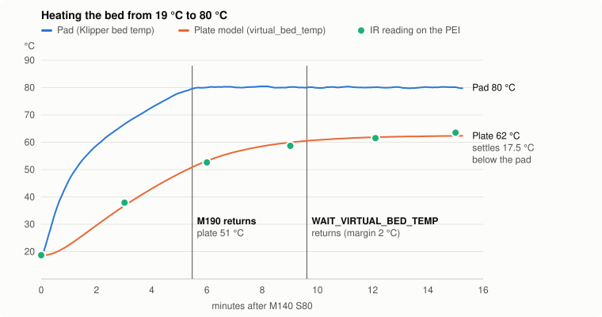

# klipper-virtual-bed-temp

A Klipper extension that estimates the **real build-plate temperature** of a heated bed whose
thermistor sits in the heater pad.

On many printers (e.g. Voron) the bed thermistor is glued into the silicone heater. The pad
reaches its target quickly, while the aluminium plate and PEI sheet lag several minutes behind and
settle well below the pad temperature. `M190` returns as soon as the pad is hot, so leveling, meshing and the first layer happen
on a plate that is still cold and still expanding.

This module adds a virtual temperature sensor, `virtual_bed_temp`, that models the plate's lag
behind the pad. It shows up in Mainsail/Fluidd next to the other sensors and gives you a
`WAIT_VIRTUAL_BED_TEMP` command for your start macro. No extra hardware is needed: calibration uses
the bed heater's own power log plus a few readings from a handheld IR thermometer.

**Tested on:** Voron 2.4 (Tap), Klipper `v0.13.0-786-g461c4e37`, MainsailOS on Debian 13 (trixie),
Python 3.13.

## Model

A first-order thermal lag, updated once per second:

```
dT_plate/dt = ((T_pad − T_plate) − loss · (T_plate − T_ambient)) / time_constant
```

| Parameter       | Meaning                                                                           |
|-----------------|-----------------------------------------------------------------------------------|
| `time_constant` | Seconds for the plate to cover ~63 % of a temperature step. Voron 2.4: 203 s.     |
| `loss`          | Optional: how far the surface settles below the pad at equilibrium. 0 = none.     |
| `ambient_temp`  | Temperature the plate loses heat to (only used when `loss > 0`).                  |

At equilibrium the plate settles at `(T_pad + loss · T_ambient) / (1 + loss)`.

### M190 finishes long before the plate is hot

The bed temperature Klipper shows, and the one `M190` waits for, is the heater pad's. The plate on
top of it lags several minutes behind. On the Voron above, heating from 19 °C to 80 °C (IR readings
on the PEI):



| Time after `M140 S80` | Pad (Klipper) | Plate (IR) |
|---|---|---|
| 3 min | 66 °C | 38 °C |
| 5.5 min: pad at target, **`M190` returns** | 80 °C | ≈ 51 °C |
| 9 min | 80 °C | 59 °C |
| 12 min | 80 °C | 61.5 °C |
| 15 min | 80 °C | 63.5 °C |

When `M190` returned, the plate was still about 12 °C short of where it settles and was still
heating and expanding. A start macro that homes, levels and meshes right after `M190` measures a
plate that keeps moving afterwards, and the first layer goes down on a surface that's too cold.
`WAIT_VIRTUAL_BED_TEMP` waits about 4 minutes more, until the plate is within 2 °C of where it
settles.

### The plate also settles below the bed target

The table shows a second effect: even when fully soaked, the PEI stays well below the pad. That is
what `loss` describes. Expect it to be large on a bed whose heater is power-limited or that sits in
an open or unheated enclosure. On the Voron (`max_power: 0.6`, loss 0.40), the plate settles about
**18 °C below the bed target at 80 °C**. A slicer bed temperature is a pad temperature, not a plate
temperature. To get a given plate temperature, set the bed to

```
T_bed = T_plate · (1 + loss) − loss · T_ambient
```

With the Voron values (loss 0.402, ambient 19 °C):

| Plate wanted | Bed target |
|---|---|
| 50 °C | 63 °C |
| 60 °C | 77 °C |
| 70 °C | 91 °C |
| 80 °C | 105 °C |

Check the result against your bed's `max_temp`. `steady_state` in the status fields shows the plate
temperature the current target leads to.

The estimate starts at the pad temperature when Klipper starts, which assumes pad and plate are
at the same temperature at that point. If Klipper restarts while the bed is still warming up or
cooling down, use `SET_VIRTUAL_BED_TEMP TEMP=` to correct it.

## Installation

```bash
cd ~
git clone https://github.com/mspi92/klipper-virtual-bed-temp.git
~/klipper-virtual-bed-temp/install.sh
```

`install.sh` symlinks `virtual_bed_temp.py` into `~/klipper/klippy/extras/`, hides the link from
Klipper's git status (so Moonraker doesn't report Klipper as dirty), and restarts Klipper.
Environment overrides: `KLIPPER_PATH`, `KLIPPER_SERVICE`, `NO_RESTART=1`.
Remove it with `install.sh --uninstall`, after deleting the config section.

### Updates via Mainsail / Fluidd

Add to `moonraker.conf` (see `examples/moonraker.conf`):

```ini
[update_manager klipper-virtual-bed-temp]
type: git_repo
path: ~/klipper-virtual-bed-temp
origin: https://github.com/mspi92/klipper-virtual-bed-temp.git
primary_branch: main
managed_services: klipper
install_script: install.sh
```

## Configuration

```ini
[virtual_bed_temp]
heater: heater_bed        # heater whose temperature drives the model
time_constant: 300        # s, > 10; from calibration
#loss: 0                  # 0..1; from calibration
#ambient_temp: 22         # °C
```

For more than one bed or zone, use named sections such as `[virtual_bed_temp plate2]` and add
`SENSOR=plate2` to the commands.

### Waiting for the plate before a print

Add `WAIT_VIRTUAL_BED_TEMP` right after the bed heat-up (`M190`) and **before** homing, QGL, Z-tilt,
probing or meshing. Those steps then run on a plate that has stopped expanding. Put it in one of
two places:

**In your `PRINT_START` macro** (`printer.cfg` or a macro file), if you have one:

```ini
[gcode_macro PRINT_START]
gcode:
    
    M190 S{bed}                       ; heater pad at target
    WAIT_VIRTUAL_BED_TEMP MARGIN=2    ; plate within 2 °C of where it will settle
    G28
    ; … QGL / Z_TILT_ADJUST, BED_MESH_CALIBRATE, nozzle heat-up, purge …
```

**Or in your slicer's start G-code**, if the slicer heats the bed itself:

```
M190 S[bed_temperature_initial_layer_single]   ; OrcaSlicer; PrusaSlicer: [first_layer_bed_temperature]
WAIT_VIRTUAL_BED_TEMP MARGIN=2
G28
; … rest of your start G-code
```

To make the wait optional per print, pass a parameter through, e.g.
`` and skip the command when it is 0.

How it behaves:
- It waits until the plate is within `MARGIN` °C of its *steady state* for the current heater target,
  not of the target itself. With `loss > 0` the plate never reaches the target, so waiting for the
  target would never finish.
- From cold on the Voron above, it returned about 4 minutes after `M190` (9.6 min after the heater
  was switched on, bed 80 °C). On a bed that's already warm it returns sooner or at once.
- If the heater is off or gets turned off, it returns immediately.
- Like `M190`, it blocks the G-code queue while waiting.

`TEMPERATURE_WAIT SENSOR=virtual_bed_temp MINIMUM=…` also works, but you have to work out the
minimum yourself.

## G-code commands

| Command | Description |
|---|---|
| `SET_VIRTUAL_BED_TEMP [SENSOR=] [TIME_CONSTANT=] [LOSS=] [TEMP=]` | Change parameters at runtime. `TEMP=` resets the estimate. Always prints the current values. Changes are lost on restart. |
| `WAIT_VIRTUAL_BED_TEMP [SENSOR=] [MARGIN=2]` | Wait for the plate to soak (see above). |

Status fields (`printer.virtual_bed_temp`): `temperature`, `time_constant`, `loss`,
`ambient_temp`, `steady_state` (plate equilibrium for the current heater target, 0 when the heater is off).

## Calibration

One heat-up of about 15 minutes (15 min on the Voron above), plus a handheld IR thermometer. No extra sensor needed.

**How it works.** Two independent sources:
- **Heater power.** Once the pad reaches its target, the heater only has to replace the heat flowing
  into the plate, plus some losses that stay roughly constant. That flow shrinks as the plate
  catches up, so in theory the heater power fades at exactly the plate's rate,
  `P(t) ≈ P_steady + A·e^(−t/τ)`. Moonraker logs the power once per second, and no heater wattage
  or plate mass is needed.
- **IR readings** of the plate surface. They give `loss` and an independent estimate of the rate.

When the two agree, the rate comes from the power and `loss` from the readings. On a real Voron
whose heater is limited by `max_power: 0.6`, the pad took 5–6 minutes to reach its target. That
left only a short, noisy power decay, and three runs on the same plate gave rates of 188 s, 278 s
and 378 s. The IR readings agreed between those runs (156 s, 160 s and 145 s). So when power and readings disagree by
more than 25 % and there are at least 3 readings, the result comes from the readings alone, and the
script says so.

### Interactive (recommended): `tools/calibrate.py`

Run it on the Klipper host, i.e. the Pi, over SSH:

```bash
python3 ~/klipper-virtual-bed-temp/tools/calibrate.py
```

What it does:
- Checks Klipper: it must be ready, not printing, with the bed heater off. It also checks that the bed
  temperature is stable.
- Asks for a first IR reading as the starting value, then starts heating with `M140 S80`.
- Records bed temperature and heater power itself, once per second. No Moonraker history settings
  are needed.
- Asks for an IR reading of the plate every 3 minutes, at fixed run times (3m00s, 6m00s, 9m00s, …).
  Before each one it tells you when the next reading is due, both as run time and as clock time.
  It beeps 30 s before and again when it's time. Type the number and press Enter; the reading is
  dated 10 s before you pressed Enter, to allow for walking back to the keyboard.
- After each reading, shows how far the currently configured model is off and a preliminary fit,
  including which data it came from.
- Finishes at a scheduled reading once there is enough data: at least 15 min, at least 3 readings,
  and power data covering 1.25 plate rates (time_constant/(1+loss)). On the Voron that was 15 min.
  Then it prints the recommended values, what they're based on, and the change from your current
  config. Optionally it applies them to the running Klipper with `SET_VIRTUAL_BED_TEMP` for testing.
- Saves the session as `~/calib-<date>.json/.csv`, which `fit_tau.py --load … --csv …` can re-fit.

While it's waiting, press Enter for a menu: extra reading, finish now, or abort. Ctrl-C or a dropped
SSH connection turns the bed heater off and saves the data so far.
Options: `--target`, `--interval`, `--entry-delay`, `--min-duration`, `--moonraker`
(default `http://localhost:7125`).

### Manual: record, then `tools/fit_tau.py`

#### 1. Prepare (once)

The heat-up has to fit in Moonraker's temperature history, which is 20 minutes by default.
Raise it in `moonraker.conf` and restart Moonraker:

```ini
[data_store]
temperature_store_size: 3600   # seconds of history
```

#### 2. Record

1. **Start at equilibrium.** Leave the bed off for at least 1 h so pad and plate are at room temperature.
2. Send `M140 S80` and start a stopwatch at the same moment. A large temperature step gives
   the best resolution.
3. Take an IR thermometer reading of the plate surface near the centre every 3 minutes
   (3, 6, 9, 12, 15 min). At least 3 readings are needed for the fallback to readings alone.

   Measure on the PEI sheet (emissivity ≈ 0.9). Bare aluminium reflects too much for IR to read
   correctly. Hold the thermometer the same way each time.
4. Wait until at least 15 minutes have passed, with nothing else heating or moving.

Write the readings to `ir.csv` as `seconds_since_M140,temp`:

```
180,38.5
360,52.0
540,58.9
720,62.1
900,63.6
```

#### 3. Fit

On any machine that can reach Moonraker:

```bash
python3 tools/fit_tau.py --moonraker http://<printer>:7125 --csv ir.csv --save run1.json
```

The output includes:
- the power fit (`P = … · exp(−t/τ)`);
- how far the model is off from your readings (RMS);
- a **cross-check** fitted from the readings alone, with a warning if it disagrees with the power
  fit by more than 25 %;
- a ready-to-paste `[virtual_bed_temp]` section and the expected soak times.

Without `--csv`, the tool fits from power alone and uses `loss: 0`. Use `--load run1.json` to
re-run the fit on saved data. `--skip` (default 120 s) leaves out the controller's settling
period after the pad first reaches its target.

#### 4. Check

Put the values in your config and restart Klipper. On a later cold heat-up to a different
target (e.g. 60 °C), compare an IR reading with the `virtual_bed_temp` value in Mainsail.

**Accuracy.** In simulations with a noisy controller and IR readings off by ±1 °C, the tool
recovered `time_constant` within about 5 % (see `tests/`). Real hardware is less ideal. On the
Voron above, three runs fitted from readings alone gave time constants of 218, 221 and 203 s (loss
0.38–0.40). A joint fit of all eleven readings matched them to within 0.83 °C rms. The weakest link is the IR thermometer's absolute accuracy, which
mainly affects `loss`.

**Other reference sensors.** A thermistor taped to the plate and declared as
`[temperature_sensor …]` also works: use `--ref "temperature_sensor plate_ref"` instead of `--csv`.

**Why not use the nozzle as the reference?** A cold nozzle resting on the bed touches it over a
tiny area. The heater block is a large mass that also loses heat to the air, the heat break and
the fans, so it reads many degrees low and adds its own lag. The resulting `time_constant` would
be wrong.

## Development

```bash
python3 -m unittest discover -s tests
```

The tests need only the Python standard library, with no Klipper checkout or printer.
`tests/sim.py` simulates a heated bed with two parts, the heater pad and the plate, each with its
own heat capacity, and a noisy PI temperature controller. The model under test only describes the
plate, so these tests check the calibration method against physics it doesn't assume.
- `test_fit.py`: fitting accuracy with noisy IR readings, the cross-check warning, and the CLI.
- `test_calibrate.py`: `calibrate.py` end to end against a time-accelerated simulated printer,
  including idle-timeout handling and aborting.
- `test_module.py`: the Klipper module, with stand-ins for Klipper's printer, reactor, heater and
  G-code objects.

## License

GPLv3, the same as Klipper. See `LICENSE`.
